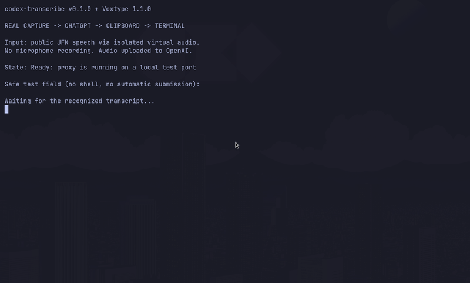
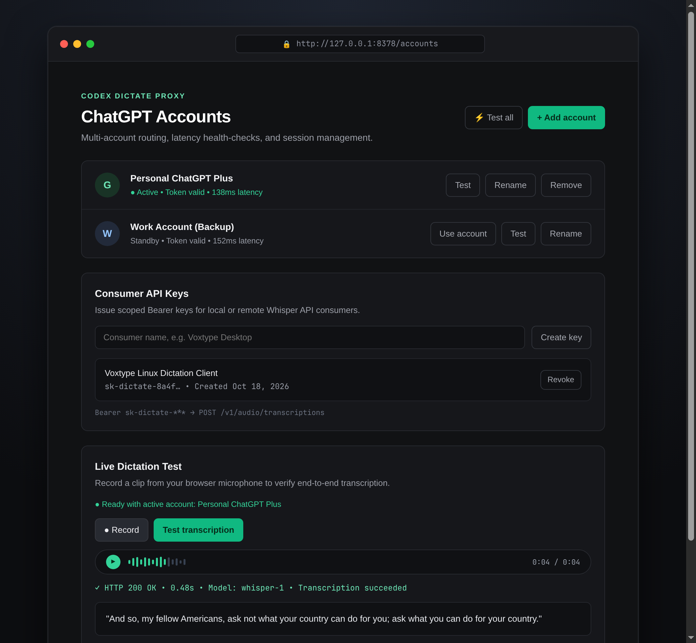
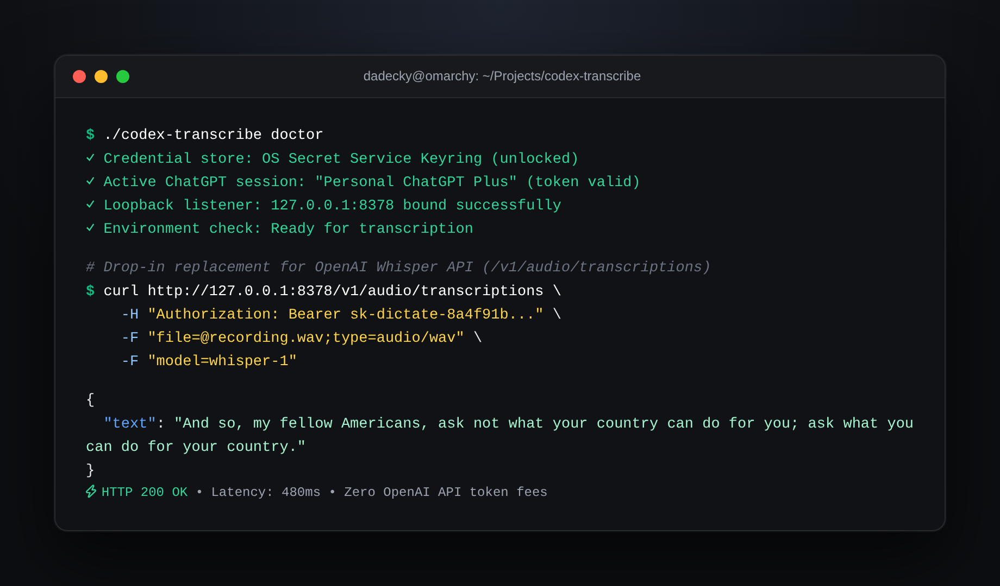

# Codex Transcribe 🎙️

> **Fast, private speech-to-text proxy powered by ChatGPT.**  
> Drop-in replacement for the OpenAI Whisper API — zero platform fees, multi-account routing, and instant desktop dictation.

[](go.mod)
[](LICENSE)
[](compose.yaml)
[](#-api-usage--terminal-example)

---

## ⚡ Live Demo: Push-to-Talk Desktop Dictation

Speak anywhere on your desktop and have your speech transcribed directly into any application or terminal via [Voxtype](docs/voxtype.md):



---

## ✨ Key Features

- **⚡ Drop-in OpenAI Whisper API:** Fully compatible with `POST /v1/audio/transcriptions`. Any client built for OpenAI Whisper works out of the box.
- **💰 Zero API Token Fees:** Uses your existing ChatGPT account session via Codex authentication.
- **🖥️ Modern Web Dashboard:** Manage multiple ChatGPT accounts, monitor token health & latency, and issue scoped consumer API keys.
- **🎙️ Built-in Audio Playground:** Record, listen back, and test transcription with live latency metrics directly in your browser.
- **🐧 System-wide Voice Typing:** Pre-configured [Voxtype integration](docs/voxtype.md) for global Linux push-to-talk speech-to-text.
- **🔒 Privacy & Security:** Local loopback by default, OS Secret Service keyring storage, password-protected dashboard, and zero server-side audio retention.
- **🐳 One-Command Deployment:** Run anywhere with lightweight Docker Compose or standalone Go binaries.

---

## 🖥️ Web Management Dashboard

Access the built-in dashboard at `http://127.0.0.1:8378/accounts` to manage ChatGPT accounts, generate consumer API keys, and run live mic tests:



---

## 🚀 Quick Start

### Option 1: Docker Compose (Recommended)

```sh
git clone https://github.com/DaDecky/codex-transcribe.git
cd codex-transcribe
docker compose up -d --build
```
Open **`http://127.0.0.1:8378/accounts`**, set your dashboard password, sign in to ChatGPT, and create a consumer API key.

### Option 2: Pre-built Binary

Download and verify the latest release for Linux / macOS:

```sh
version=v0.1.1
platform=$(uname -s | tr '[:upper:]' '[:lower:]')
arch=$(uname -m | sed 's/x86_64/amd64/; s/aarch64/arm64/; s/arm64/arm64/')
archive="codex-transcribe_${version}_${platform}_${arch}.tar.gz"

curl -fLO "https://github.com/DaDecky/codex-transcribe/releases/download/${version}/${archive}"
tar -xzf "${archive}"

./codex-transcribe doctor
./codex-transcribe -listen 127.0.0.1:8378
```

### Option 3: Build from Source

Requires Go 1.27.1+:

```sh
git clone https://github.com/DaDecky/codex-transcribe.git
cd codex-transcribe
go build -o codex-transcribe .
./codex-transcribe
```

---

## 💻 API Usage & Terminal Example



Send any audio file to the proxy just like you would with the official OpenAI API:

```sh
curl http://127.0.0.1:8378/v1/audio/transcriptions \
  -H "Authorization: Bearer sk-dictate-YOUR_KEY" \
  -F "file=@recording.wav;type=audio/wav" \
  -F "model=whisper-1"
```

**Response (`application/json`):**
```json
{
  "text": "And so, my fellow Americans, ask not what your country can do for you; ask what you can do for your country."
}
```

*Pass `-F "response_format=text"` for plain text output.*

---

## 🎙️ Desktop Voice Typing with Voxtype

Turn `codex-transcribe` into a system-wide push-to-talk voice typing tool on Linux:

```sh
# Automated installer for Linux (systemd user service)
python3 scripts/install-voxtype.py install
```

Hold your hotkey (e.g. `Super + D`), speak, and your words are typed directly into the active window. See [docs/voxtype.md](docs/voxtype.md) for custom bindings, audio devices, and service controls.

For Oh My Pi users, native recording is managed automatically via [omp-dictation](https://github.com/DaDecky/omp-dictation).

---

## ⚙️ Configuration & Flags

| Flag / Environment Variable | Default | Description |
| --- | --- | --- |
| `-listen` | `127.0.0.1:8378` | Host and port to bind |
| `CODEX_DICTATE_CREDENTIAL_STORE` | `keyring` | Credential backend (`keyring` or `file`) |
| `CODEX_DICTATE_PUBLIC_URL` | *(none)* | Public HTTPS origin when running behind reverse proxy |
| `CODEX_TRANSCRIBE_API_KEY` | *(none)* | Optional static consumer Bearer key |
| `-auth-file` | `~/.codex/auth.json` | Explicit path for legacy Codex auth file |
| `-timeout` | `90s` | Upstream transcription timeout |
| `-max-upload-mib` | `25` | Maximum multipart request size (1–1024 MiB) |

---

## 📚 Documentation

- [Production VPS & Caddy Deployment](docs/production.md) — Automatic HTTPS, custom domain, and hardened reverse proxy.
- [Docker Setup Guide](docs/docker.md) — Volumes, environment configuration, and persistence.
- [Voxtype Integration Guide](docs/voxtype.md) — Push-to-talk setup, sound devices, and desktop insertion.
- [Integration Demo Notes](docs/demo.md) — Details on the test audio and pipeline verification.

---

## ⚠️ Disclaimer

This is an unofficial integration calling ChatGPT's internal `/backend-api/transcribe` endpoint via Codex authentication. It is not affiliated with or endorsed by OpenAI. Use your own account in compliance with OpenAI terms.

---

## 📄 License

MIT © [DaDecky](https://github.com/DaDecky). Acknowledgments to [sicko7947](https://github.com/sicko7947) for inspiration and initial browser headers.
